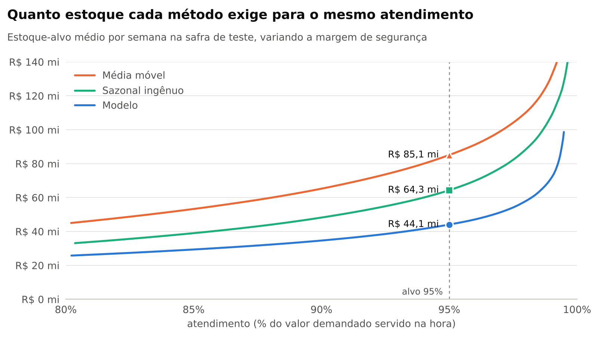
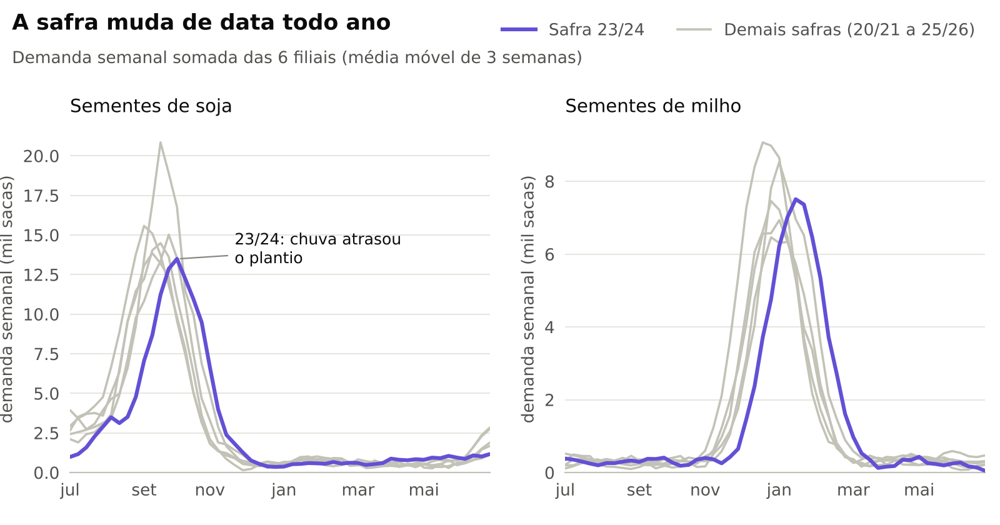
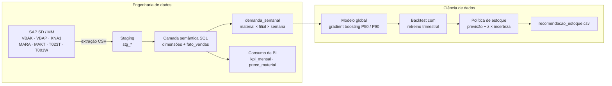
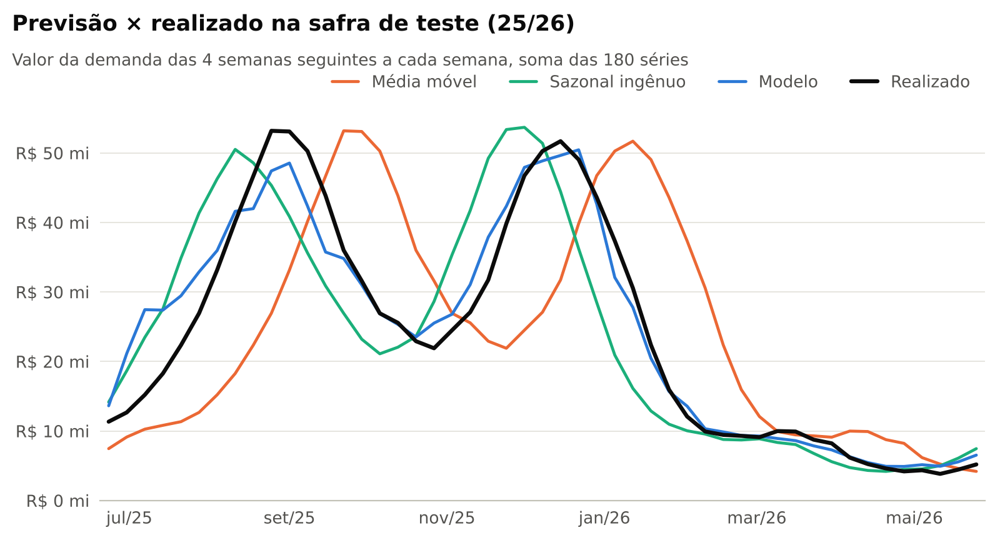
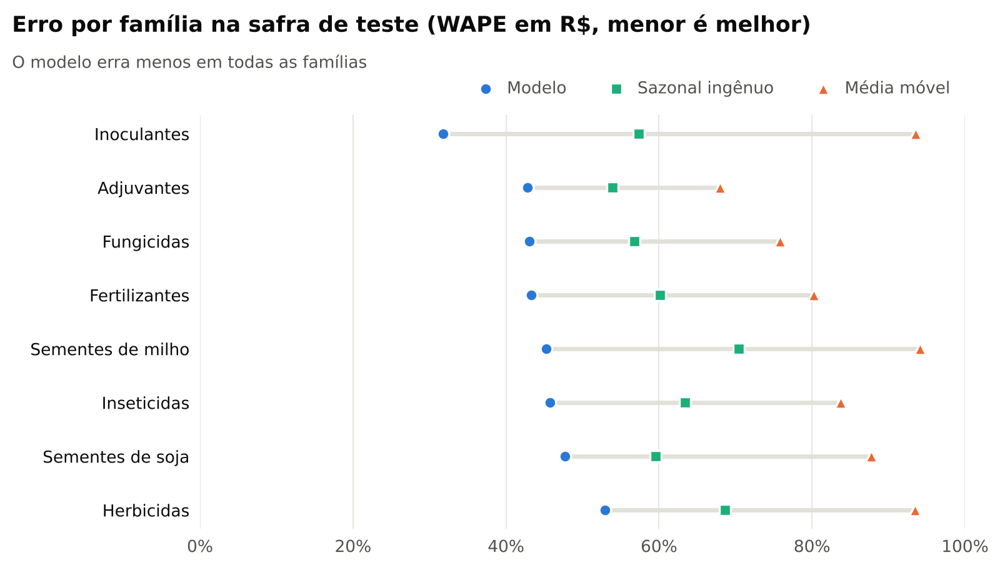

# Previsão de demanda de insumos agrícolas: do SAP à decisão de estoque

[](https://github.com/Pessoa1998/previsao-demanda-agro/actions/workflows/ci.yml)


Case de ponta a ponta: **extração no formato do SAP SD → camada semântica em SQL (no estilo das
views do SAP Datasphere) → previsão de demanda → recomendação de estoque.**

> **Pergunta de negócio:** quanto de cada insumo cada filial precisa ter em estoque para atender as
> próximas 4 semanas (o lead time de reposição) sem empatar capital à toa?

O cenário é uma distribuidora **fictícia** de sementes, fertilizantes e defensivos com 6 filiais em
Mato Grosso. Os dados são **100% sintéticos**, gerados com a sazonalidade real da safra (soja no
2º semestre, milho safrinha no 1º) e com os problemas típicos de uma extração SAP.

## Resultados na safra de teste (25/26)

| | Modelo | Sazonal ingênuo | Média móvel 4 sem. |
|---|:-:|:-:|:-:|
| **Erro (WAPE em R$, menor é melhor)** | **45,0%** | 62,6% | 85,4% |
| **Estoque médio para 95% de atendimento** | **R$ 44,1 mi** | R$ 64,3 mi | R$ 85,1 mi |
| Estoque a mais que o modelo exigiria | — | +46% | +93% |

**No mesmo nível de atendimento, o modelo exige 31% menos estoque que o sazonal ingênuo e 48% menos
que a média móvel.** É capital de giro que deixa de ficar parado no armazém.

<picture>
  <source media="(prefers-color-scheme: dark)" srcset="https://raw.githubusercontent.com/Pessoa1998/previsao-demanda-agro/main/reports/figures/tradeoff-estoque-escuro.png">
  
</picture>

## Por que é difícil: a safra muda de data todo ano

A demanda se concentra em poucas semanas e o pico anda conforme a chuva. Na safra 23/24 o plantio
atrasou e quem copiou o calendário do ano anterior comprou cedo demais.

<picture>
  <source media="(prefers-color-scheme: dark)" srcset="https://raw.githubusercontent.com/Pessoa1998/previsao-demanda-agro/main/reports/figures/sazonalidade-escuro.png">
  
</picture>

## Arquitetura



## 1. Extração SAP e camada semântica

A extração chega como no mundo real: tudo texto, com chaves cheias de zeros e movimentos que não são
demanda. As views em [`sql/`](sql) resolvem isso antes de qualquer modelo:

| Tabela SAP | Conteúdo | Tratamento na camada SQL |
|---|---|---|
| `VBAK` / `VBAP` | cabeçalho e itens da ordem de venda | remove 300 linhas duplicadas pela carga delta (`VBELN + POSNR`), converte `ERDAT` (DATS) em data |
| `VBAP-ABGRU` | motivo de recusa do item | 948 itens recusados ficam fora da demanda |
| `VBAK-AUART` | tipo de ordem | `ZVEN` e `ZBON` (bonificação) consomem estoque e entram; 1.045 itens de devolução `ZDEV` saem |
| `MARA` / `MAKT` / `T023T` | material, descrições e família | conversão ALPHA (`000000000000100101` → `100101`) e filtro de idioma (`SPRAS = 'P'`) |
| `KNA1` / `T001W` | clientes e filiais | dimensões de cliente e centro |

O resultado é a tabela `demanda_semanal`: 180 séries (material × filial) com todas as semanas
preenchidas, inclusive as sem venda.

<details>
<summary><b>Equivalências para levar as views ao SAP Datasphere (HANA SQL)</b></summary>
<br>

As views foram escritas em SQL quase padrão para rodar localmente no DuckDB. Ao portar:

| DuckDB (este repositório) | SAP HANA SQL (Datasphere) |
|---|---|
| `STRPTIME(ERDAT, '%Y%m%d')::DATE` | `TO_DATE(ERDAT, 'YYYYMMDD')` |
| `DATE_TRUNC('week', data)` | `ADD_DAYS(data, -WEEKDAY(data))` |
| `GENERATE_SERIES(ini, fim, INTERVAL 7 DAY)` | `SERIES_GENERATE_DATE('INTERVAL 7 DAY', ini, fim)` |
| `SUM(x) FILTER (WHERE cond)` | `SUM(CASE WHEN cond THEN x END)` |
| `LTRIM(MATNR, '0')`, `ROW_NUMBER() OVER (...)` | iguais |

</details>

## 2. Modelagem

- **Alvo:** demanda acumulada das **4 semanas seguintes** a cada semana, por material × filial.
- **Features** (só com o que se sabia até a semana da previsão): nível recente da série; o mesmo
  período do ano anterior, inclusive deslocado em ±2 semanas; a razão entre as últimas semanas e o
  ano anterior na série, na família da filial e na família inteira (é ela que denuncia o plantio
  adiantado ou atrasado); semana da safra, família, filial e material.
- **Modelo global** `HistGradientBoostingRegressor`: perda Poisson para a previsão central e perda
  quantílica (P90) para a incerteza. Séries normalizadas pela própria escala, treino ponderado por R$.
- **Baselines:** média móvel das últimas 4 semanas e sazonal ingênuo (mesmo período do ano anterior).
- **Backtest honesto:** retreino a cada 13 semanas só com janelas cujo resultado já era conhecido.
  Safra 24/25 para calibração e 25/26 para teste. Um teste automatizado altera o futuro e confirma
  que nenhuma feature muda (sem vazamento).

| WAPE em R$ | Modelo | Sazonal ingênuo | Média móvel |
|---|:-:|:-:|:-:|
| Calibração (safra 24/25) | **67,2%** | 77,0% | 85,4% |
| Teste (safra 25/26) | **45,0%** | 62,6% | 85,4% |

<picture>
  <source media="(prefers-color-scheme: dark)" srcset="https://raw.githubusercontent.com/Pessoa1998/previsao-demanda-agro/main/reports/figures/previsao-vs-real-escuro.png">
  
</picture>

<picture>
  <source media="(prefers-color-scheme: dark)" srcset="https://raw.githubusercontent.com/Pessoa1998/previsao-demanda-agro/main/reports/figures/erro-por-familia-escuro.png">
  
</picture>

## 3. Da previsão à decisão

A mesma regra vale para os três métodos: **estoque-alvo = previsão + z × incerteza**. Nos
baselines, a incerteza é o desvio-padrão histórico do erro de cada série (o estoque de segurança
clássico, fixo o ano todo). No modelo, ela vem do P90 e é **condicional**: cresce no pico da safra
e encolhe na entressafra. O serviço é medido como **atendimento em valor** (fill rate): a fração do
R$ demandado que seria atendida na hora.

A curva do topo varia `z` e mostra o custo de cada método em qualquer nível de serviço. É a
comparação justa entre eles.

**Ponto de atenção:** calibrando `z` na safra 24/25 e aplicando na 25/26, todos os métodos ficaram
conservadores (atendimento de 99,2% no modelo, 97,2% no sazonal e 93,6% na média móvel). A 24/25
foi mais volátil, com lançamento de cultivar, saída de outra e choque no milho. Em produção, `z` é
recalibrado periodicamente com o erro mais recente.

A saída operacional é [`reports/recomendacao_estoque.csv`](reports/recomendacao_estoque.csv): o
estoque-alvo por material e filial para as próximas 4 semanas.

## Como rodar

```bash
pip install -r requirements.txt
make tudo        # testes + pipeline completo (~2 min)
```

Ou com Docker:

```bash
docker build -t previsao-demanda-agro .
docker run --rm -v "$PWD/reports:/app/reports" previsao-demanda-agro
```

O passo a passo comentado está no notebook
[`notebooks/case_previsao_demanda.ipynb`](notebooks/case_previsao_demanda.ipynb).

## Estrutura

```text
├── sql/                       camada semântica (staging → dimensões → fato → demanda → BI)
├── src/demanda/
│   ├── gerar_dados.py         extração SAP sintética (VBAK, VBAP, KNA1, MARA, MAKT, T023T, T001W)
│   ├── camada_sql.py          monta o warehouse DuckDB e o relatório de qualidade
│   ├── features.py            base supervisionada sem vazamento
│   ├── modelos.py             gradient boosting P50/P90 e backtest com retreino
│   ├── avaliacao.py           WAPE, viés, atendimento e política de estoque
│   ├── graficos.py            figuras (tema claro e escuro)
│   └── pipeline.py            orquestra tudo
├── tests/                     dados, regras SQL, vazamento e métricas
├── notebooks/                 narrativa do case com resultados
└── reports/                   métricas, recomendação de estoque e figuras
```

## Em produção, isso viraria

1. As views de `sql/` como views no **SAP Datasphere**, sobre as tabelas replicadas do S/4HANA ou ECC.
2. O pipeline Python em contêiner, agendado toda semana, lendo `demanda_semanal`.
3. Previsões e estoque-alvo gravados de volta numa tabela do Datasphere e consumidos no **Power BI**,
   com o WAPE por família monitorado todo mês.

## Limitações

- Dados sintéticos: preço, crédito, clima e campanhas comerciais não estão modelados.
- Lead time fixo de 4 semanas para todos os itens.
- Itens novos dependem dos sinais da família até acumularem histórico próprio.

---

Feito por **Gabriel Pessoa Lima** · [LinkedIn](https://www.linkedin.com/in/gabriel-pessoa-5bb78b12a/) · [GitHub](https://github.com/Pessoa1998)
